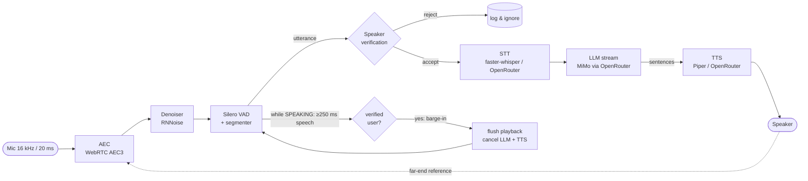
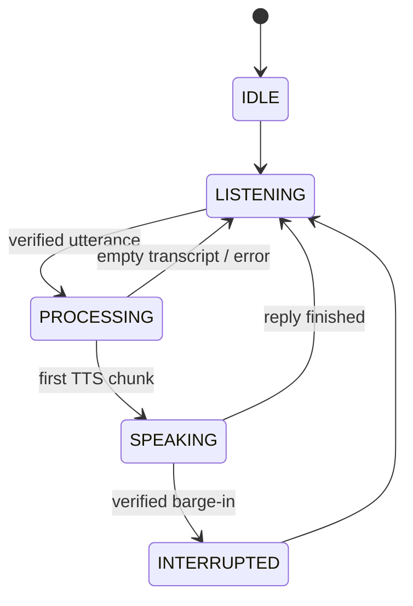

# VoiceModule

A local voice assistant loop. It listens all the time, responds **only to your enrolled voice**, ignores
noise and other people, cancels its own echo from the speakers, and can be **interrupted mid-sentence**
(barge-in). The only cloud AI calls go to **OpenRouter** (`https://openrouter.ai/api/v1`). The LLM is Xiaomi MiMo.

## Architecture





**Threads:**
- PortAudio callbacks push frames into thread-safe queues.
- A DSP thread runs AEC → denoise → VAD → segmenter (≈3 ms per 20 ms frame).
- The asyncio loop runs speaker verification, STT, LLM streaming, TTS and the state machine. Speaker embeddings
  never run on the DSP thread, so capture never stalls.

| Interface (`voice/interfaces.py`) | Implementations |
|---|---|
| `AudioInput` / `AudioOutput` | `SoundDeviceInput` / `SoundDeviceOutput` (`voice/audio_io.py`) |
| `AECProcessor` | `WebRTCAEC` (AEC3), `SpeexAEC`, `GateAEC` (fallback), `NoAEC` (`voice/aec.py`) |
| `Denoiser` | `RNNoiseDenoiser`, `DeepFilterNetDenoiser`, `PassthroughDenoiser` (`voice/denoise.py`) |
| `VADDetector` | `SileroVAD`, `EnergyVAD` (degraded fallback) (`voice/vad.py`) |
| `SpeakerVerifier` | `ProfileSpeakerVerifier` + Resemblyzer / ECAPA-TDNN embedders (`voice/speaker.py`) |
| `STTEngine` | `WhisperSTT` (local), `OpenRouterSTT` (`voice/stt.py`) |
| `LLMClient` | `OpenRouterClient` (`voice/openrouter.py`) |
| `TTSEngine` | `PiperTTS` (local), `OpenRouterTTS` (`voice/tts.py`) |

## Setup

Python 3.11+ (tested on 3.13, Windows 10/11, CPU). A CUDA GPU is used automatically if available.

```bash
python -m venv .venv && .venv\Scripts\activate      # Linux/macOS: source .venv/bin/activate
pip install -r requirements.txt
copy .env.example .env                               # then put your key in OPENROUTER_API_KEY
python main.py --check                               # verifies the key + model slugs, streams a test reply
```

**Local TTS voice (Mode B, the default).** Download a Piper voice into `models/`:

```bash
mkdir models
curl -L -o models/en_US-lessac-medium.onnx      https://huggingface.co/rhasspy/piper-voices/resolve/main/en/en_US/lessac/medium/en_US-lessac-medium.onnx
curl -L -o models/en_US-lessac-medium.onnx.json https://huggingface.co/rhasspy/piper-voices/resolve/main/en/en_US/lessac/medium/en_US-lessac-medium.onnx.json
```

On first run, faster-whisper, Silero and Resemblyzer download or load their own model weights. After that,
everything except the OpenRouter calls runs offline.

## Enrollment

```bash
python enroll.py              # 8 phrases x 4 s (use --phrases 5..10)
python calibrate.py           # leave-one-out scores -> suggested threshold
python calibrate.py --live 3 --impostor friend.wav --write   # better: fresh samples + another voice, write to config
```

- Enroll in the room and at the mic distance you'll actually use.
- `enroll.py` rejects takes that are too quiet or clipped.
- It writes `profile/voice.npy` (the L2-normalised centroid), `profile/enroll_embeddings.npy` and `profile/profile.json`.

## Web UI

```bash
python -m ui.server            # opens http://127.0.0.1:8765
python -m ui.server --no-browser --port 9000
```

A local dashboard with five pages:
- **Live**: start/stop, mute. It shows an animated state orb (listening / thinking / speaking /
  interrupted), mic and voice-activity meters, accepted/rejected speaker scores, and the conversation with
  streaming replies and per-turn latency. You can also type messages; they skip STT and the reply is still spoken.
  Interruption is fully autonomous: talk over the assistant and it stops — there is no interrupt button or hotkey.
- **Metrics**: p50/p95 for every stage against its target, end-to-end latency per turn vs the 1.5 s target,
  and a stacked STT / LLM / TTS breakdown per turn.
- **Voice profile**: mic check with a live meter, then guided recording of 5–10 phrases with quality checks.
  It finishes with a histogram of your scores and a draggable threshold that you apply with one click.
- **Settings**: every `config.yaml` option, grouped, with device dropdowns and an OpenRouter model check.
  Saving keeps the YAML comments and restarts the assistant if it's running.
- **Logs**: a live, filterable log you can download.

Shortcuts: `Ctrl+Space` start/stop, `M` mute.

How it works:
- The UI runs the same `VoiceAssistant` in-process (`ui/server.py`, FastAPI) and streams its events over a WebSocket.
- Audio stays in Python. The browser never receives raw audio, the API key or `.env`.
- It binds to `127.0.0.1` only. To use it from another device, run `--host 0.0.0.0` with a `UI_TOKEN=...`
  environment variable and open `/?token=...`.
- The frontend is plain HTML/CSS/JS (`ui/static/`): no build step, no CDN, works offline.

## Running from the CLI

```bash
python main.py                # full voice loop. Ctrl+C to quit (prints per-stage latency p50s)
python main.py --devices      # list audio devices; set audio.input_device / output_device in config.yaml
python main.py --text         # type instead of speaking (tests LLM + TTS without the mic)
python main.py --log-level DEBUG
```

Log lines include per-stage timings, for example:
`accepted speaker score=0.81`, `first audio e2e_ms=980`, `interrupted stop_ms=3.1`, `rejected speaker score=0.42`.

## Configuration (`config.yaml`)

Every threshold is tunable. The most important ones:

| Key | Default | Meaning |
|---|---|---|
| `speaker.threshold` | 0.65 | cosine similarity required to accept a speaker |
| `speaker.min_segment_ms` | 400 | shorter utterances are ignored |
| `barge_in.min_speech_ms` | 250 | verified speech needed to interrupt |
| `vad.threshold` | 0.5 | Silero speech probability |
| `vad.hangover_ms` | 500 | trailing silence that ends an utterance (lower = faster replies, more cut-offs) |
| `vad.pad_ms` | 200 | pre-roll kept before speech onset |
| `aec.backend` | webrtc | `webrtc` / `speex` / `gate` / `none` |
| `aec.delay_ms` | auto | playback→capture delay hint |
| `stt.mode` / `tts.mode` | local | `local` (Mode B) or `openrouter` (Mode A) |
| `llm.model` | `xiaomi/mimo-v2.6-flash` | any OpenRouter slug; `main.py --check` verifies it |

### Mode A vs Mode B (STT/TTS)

OpenRouter has no dedicated speech endpoints. **Mode A** uses audio-capable chat models through `/chat/completions`:
- STT sends an `input_audio` content part (e.g. `google/gemini-2.5-flash`).
- TTS uses `modalities: ["text","audio"]` (e.g. `openai/gpt-audio-mini`).

**Mode B** runs faster-whisper and Piper on-device. It is the default because it's faster
(no extra round-trips) and free. Either way, OpenRouter is the only network destination.

## Latency

The target is under 1.5 s from end of speech to first audio. These numbers were **measured** on the dev machine
(12-thread laptop CPU, no GPU, Windows, Python 3.13), with every component real and models warm:

| Stage | Measured (p50) |
|---|---|
| DSP per 20 ms frame (AEC3 + RNNoise + Silero) | 3.5 ms |
| Speaker verification (Resemblyzer) | 50 ms (barge-in window: 21 ms) |
| STT faster-whisper `base.en` int8 / `tiny.en` | 850 ms / 410 ms for a ~2.5 s utterance |
| LLM first token, `xiaomi/mimo-v2.6-flash`, reasoning off | 0.55–1.6 s (provider/network variance) |
| TTS first sentence (Piper lessac-medium) | 80–160 ms |
| **End of speech → first audio** | **≈2.6 s with `base.en`** |
| Barge-in: verified speech → playback stopped | 0.3 ms after detection; detection needs ≥250 ms of speech |

**Honest status:** with `base.en` on CPU and MiMo's current routing, the 1.5 s target is **not** met. The LLM's
first token is the largest and least controllable part. To get closer:
- `stt.local_model: tiny.en` saves ~450 ms (slightly lower accuracy);
- a GPU makes whisper ~5-10x faster;
- try `llm.extra_body: {provider: {sort: latency}, reasoning: {enabled: false}}`;
- lower `vad.hangover_ms` to 300–400. Note that `e2e_first_audio` is measured from the segmenter's end-of-speech
  decision, so the hangover comes **on top** of it.

All engines warm up at startup, because the first ONNX/CTranslate2/torch inference is 5–20x slower.

## Tuning tips

### Echo cancellation
- **Headphones** need no AEC: set `aec.backend: none`. Barge-in stays enabled.
- **Speakers:** keep `webrtc`. AEC3 estimates the delay itself. If you still hear self-triggering, set `aec.delay_ms`
  to your measured output+input latency (often 40–150 ms on Windows WASAPI/MME) and lower `audio.output_gain`.
- Avoid system "enhancements" (Windows: Sound → device → Properties → disable audio enhancements).
  Non-linear processing in the playback path breaks the echo canceller's model.
- If no AEC backend can load, the app logs a warning and **gates the mic while speaking**. Barge-in is then
  impossible by design.
- The barge-in check also requires speaker verification. Residual echo of the assistant's own (TTS) voice
  won't match your profile, which adds a second layer of protection.

### Speaker threshold
- **False rejects** (it ignores you): lower `speaker.threshold` by 0.05, or re-enroll with more phrases in your
  usual environment. Check the logged `score=` values for your own speech.
- **False accepts** (it responds to others): raise the threshold, or run `calibrate.py --impostor other.wav`.
  This picks the equal-error-rate point.
- Very short utterances ("yes", "stop") give unreliable embeddings. They're dropped below `speaker.min_segment_ms`.
- ECAPA-TDNN (`speaker.backend: ecapa`, needs `pip install speechbrain`) is more discriminative than
  Resemblyzer but slower. **Re-enroll after switching backends**, because embeddings aren't compatible.

## Troubleshooting

| Symptom | Fix |
|---|---|
| `speaker profile ... missing` | run `python enroll.py` |
| `OPENROUTER_API_KEY is not set` | create `.env` from `.env.example` |
| `OpenRouter HTTP 404` / model not found | `python main.py --check`; it lists candidate slugs |
| `OpenRouter HTTP 401/402` | invalid key / out of credits |
| Repeated `openrouter retry ... http 429` | rate-limited; retries back off automatically (honours `Retry-After`) |
| Assistant answers itself | speakers + no AEC: check the `AEC ready` log line; see AEC tips; use headphones |
| Cuts off the first word | raise `vad.pad_ms` |
| Replies while you pause mid-sentence | raise `vad.hangover_ms` |
| Ignores your interruptions | lower `barge_in.min_speech_ms`; check that `AEC ready backend=webrtc-aec3` (gate mode disables barge-in) |
| `Piper voice ... not found` | download the voice (see Setup) or set `tts.mode: openrouter` |
| `audio device problem - trying to restart input` | the mic was unplugged; it retries 5 times with backoff, then exits |
| `speexdsp` build fails on Windows | expected (needs swig + libspeexdsp); use the default `webrtc` backend |
| `No module named 'pkg_resources'` from `webrtcvad` | `pip install webrtcvad-wheels` (already in requirements) |
| It never hears you / wrong mic | the Windows default input may be a virtual device (DroidCam, Iriun...): `python main.py --devices`, then set `audio.input_device: "Realtek"` (name substring) |
| Reads out `**` or `#` | the reply is markdown-stripped before TTS; if a model still misbehaves, tighten `llm.system_prompt` |

## Tests

```bash
python -m pytest -q
```

The tests cover:
- the state machine;
- speaker-verification threshold logic and calibration;
- the sentence chunker;
- the OpenRouter client (mocked transport: streaming, multi-line SSE, 429/5xx/transport retries, cancellation closing the stream);
- segmenter pre-roll/hangover, delay estimation and log redaction;
- an orchestration test with fake components that checks verified-user gating, barge-in cancelling LLM + TTS,
  and that other voices and short blips can't interrupt.

## Security

- The API key is read only from the environment / `.env`, which is git-ignored.
- The log formatter masks `sk-or-…` keys and `Bearer` tokens anywhere in a line, including structured fields and tracebacks.
- Raw audio is never logged or written to disk at runtime (enrollment stores only embeddings).
